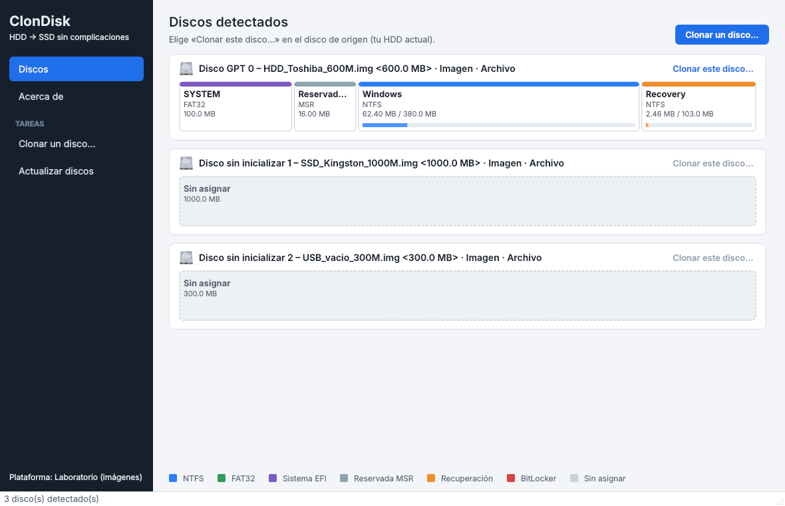
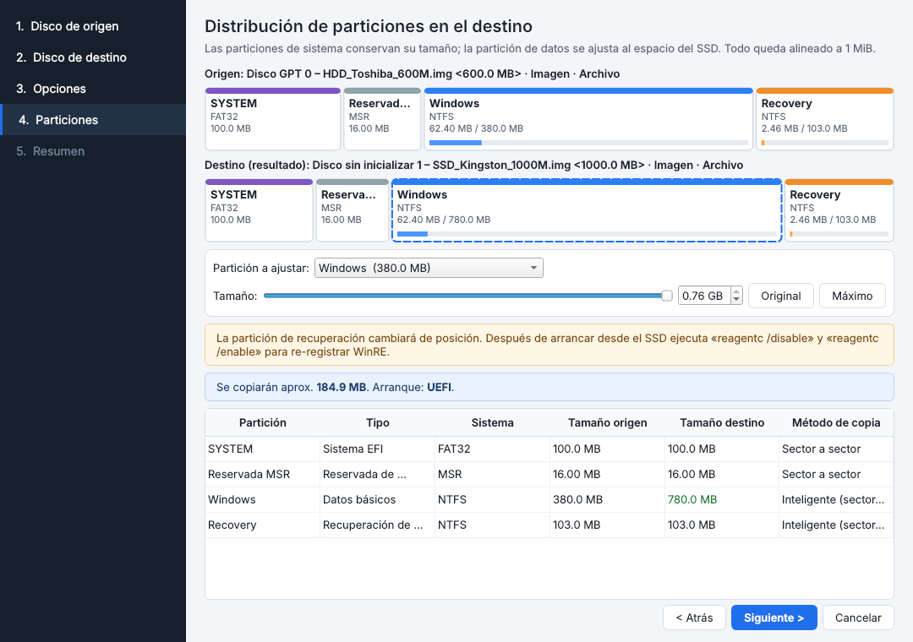
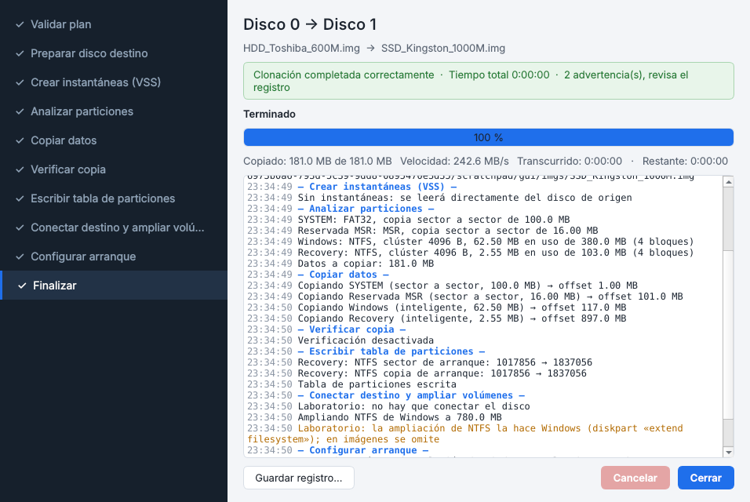

# ClonDisk

Herramienta de escritorio para **clonar un disco HDD a un SSD en Windows 10/11**, con una interfaz parecida a Macrium Reflect (Python + PySide6).

> ⚠️ Clonar discos implica escribir a bajo nivel sobre el disco destino. Haz un respaldo de tus datos importantes y prueba primero con el **modo laboratorio** o con la opción **Simulación**.

## Qué hace

- Lee la tabla de particiones **GPT o MBR** directamente de los sectores del disco.
- Conserva las particiones **EFI, MSR y de recuperación** con su tipo, atributos y nombre.
- **Alinea todas las particiones a 1 MiB**, lo óptimo para SSD (corrige discos antiguos que empiezan en el sector 63).
- **Ajusta la partición de Windows** al tamaño del SSD, ya sea más grande o más pequeño (en el segundo caso, primero reduce la partición de origen con la herramienta nativa de Windows).
- **Copia inteligente de NTFS**: lee `$Bitmap` y copia solo los clústeres en uso. FAT32, MSR y el resto se copian sector a sector.
- **Instantáneas VSS**: puedes clonar el Windows que está en ejecución y la copia queda consistente.
- Copia en *pipeline*: un hilo lee del HDD mientras otro escribe en el SSD.
- Corrige el campo *hidden sectors* de NTFS y FAT de las particiones que se movieron. El arranque BIOS lo necesita.
- Escribe la tabla de particiones **al final**, así una cancelación deja el destino vacío y no a medias.
- Amplía NTFS (`diskpart extend filesystem`), reconstruye el arranque (`bcdboot`, UEFI o BIOS) y actualiza `MountedDevices` del Windows clonado para que siga siendo `C:`.
- Envía TRIM al SSD, verifica de forma opcional e impide que el equipo se suspenda durante la copia.
- Detecta la **versión del Windows de origen** y **respalda sus drivers** (`dism /export-driver`, o copia del DriverStore si DISM no puede) en `Documentos\ClonDisk` antes de modificar nada.
- Revisa la **salud del disco de origen** y tolera **sectores ilegibles**: reintenta y, si lo eliges, los copia con ceros y anota su LBA.
- Puede **convertir el destino a GPT/UEFI** con `mbr2gpt` y **preparar Windows para otra computadora** (drivers AHCI/NVMe/Intel RST de arranque).
- Al terminar **comprueba que el destino puede arrancar** y lo muestra con ✓/✗.

### Modos de identificadores

| Modo | Qué pasa | Cuándo usarlo |
|---|---|---|
| **Nuevos (recomendado)** | GUID y firma nuevos, `bcdboot` y `MountedDevices` actualizados | Siempre que sea posible. Puedes dejar ambos discos conectados. |
| **Idénticos** | Clon exacto. Al terminar, el SSD queda *offline* para evitar colisiones | Si vas a retirar el HDD y quieres un clon exacto. En MBR conserva los offsets originales. |

## Requisitos

- Windows 10 u 11 y **Python 3.10+ de 64 bits**.
- Permisos de administrador (la app los pide con UAC).
- Servicio «Instantáneas de volumen» habilitado (viene así por defecto).
- Para **convertir a GPT/UEFI**: el equipo que ejecuta ClonDisk necesita **Windows 10 1703 (build 15063) o posterior** (trae `mbr2gpt.exe`) y el Windows clonado debe ser Windows 10 o posterior. Si no se cumple, la opción aparece deshabilitada con el motivo.

### Clonar un Windows que no está en ejecución (disco por USB)

- Si el destino es más pequeño, ClonDisk reduce la partición **del disco de origen** con Windows. En un Windows sin conexión, `powercfg /h off` no sirve (afectaría al equipo anfitrión): usa «Preparar volumen para reducir», que borra `hiberfil.sys`, `pagefile.sys`, `swapfile.sys` y las instantáneas de ese volumen. Ese Windows recrea los archivos al arrancar.
- Si el SSD irá a **otra computadora**, activa la opción correspondiente: evita `INACCESSIBLE_BOOT_DEVICE`. Windows y el software con licencia pueden pedir reactivación.
- Un origen **MBR** arranca solo en modo **BIOS/Legacy (CSM)**. Para un equipo solo-UEFI elige «Convertir a GPT/UEFI».
- Los drivers respaldados se reinstalan con `pnputil /add-driver "<carpeta>\*.inf" /subdirs /install`.

## Instalación

**Ejecutable:** descarga `ClonDisk.exe` desde la sección *Releases* del repositorio.

**Desde el código fuente:**

```bat
git clone https://github.com/angelvs18/ClonDIsk.git
cd ClonDIsk
pip install .
clondisk
```

También puedes ejecutarlo sin instalar: `pip install -r requirements.txt` y luego `python -m clondisk`.

## Uso

1. En la ventana principal, en tu HDD, pulsa **Clonar este disco…**.
2. Elige el SSD como destino.
3. Revisa las opciones. Las predeterminadas son las recomendadas.
4. Ajusta el tamaño de la partición de Windows si quieres.
5. Revisa el resumen, confirma e inicia.
6. Al terminar, apaga el equipo, desconecta el HDD (o cámbialo de lugar) y en la BIOS/UEFI elige el SSD como primer dispositivo de arranque.

### Generar un .exe

```bat
build.bat
```

El resultado queda en `dist\ClonDisk.exe` y pide permisos de administrador al abrirlo.

### Modo laboratorio (sin tocar discos reales)

Funciona en cualquier sistema operativo con archivos de imagen sin formato (`.img`):

```bash
python -m clondisk --images origen.img destino.img
```

## Arquitectura

```
clondisk/
├── core/                 # Lógica pura, independiente del sistema operativo
│   ├── model.py          # Disk / Partition, tipos GPT y MBR
│   ├── gpt.py, mbr.py    # Lectura y escritura de tablas (CRC32, MBR protector, respaldo GPT)
│   ├── fs.py             # Detección de FS, $Bitmap NTFS, etiquetas, hidden sectors
│   ├── scan.py           # Lee la estructura de un disco desde sus sectores
│   ├── planner.py        # Calcula la distribución del destino y valida
│   ├── copier.py         # Copia por rangos en pipeline, verificación y cancelación
│   └── engine.py         # Orquesta los pasos de la clonación
├── platforms/
│   ├── windows.py        # Win32 (ctypes), VSS, PowerShell, diskpart, bcdboot, registro
│   └── images.py         # Modo laboratorio con archivos de imagen
└── gui/                  # PySide6: ventana principal, asistente y progreso
```

## Limitaciones

- No admite discos dinámicos (LDM), Espacios de almacenamiento, particiones extendidas o lógicas MBR, ni volúmenes **BitLocker** activos (descífralos antes).
- El origen y el destino deben tener el **mismo tamaño de sector lógico**. Algunos adaptadores USB presentan el disco como 4Kn; si pasa, conecta el SSD por SATA o M.2, o usa otro adaptador.
- La conversión MBR → GPT depende de `mbr2gpt` (máximo 3 particiones primarias en el origen). Si falla, el destino queda en MBR y el registro muestra `setupact.log` y `setuperr.log`.
- Si la partición de recuperación cambia de posición, al arrancar desde el SSD ejecuta `reagentc /disable` y luego `reagentc /enable` para re-registrar WinRE.

## Pruebas

En Linux, con `gdisk`, `fdisk`, `ntfs-3g` y `dosfstools`:

```bash
pip install -r requirements.txt -r requirements-dev.txt
python -m pytest tests -q
```

Las pruebas crean discos GPT y MBR reales con NTFS y FAT32 y los clonan a destinos más grandes, más pequeños y con tamaño personalizado. Después validan:

- la tabla con `sgdisk -v`;
- los archivos con `ntfscat`;
- la consistencia de NTFS con `ntfsresize`;
- la partición EFI con `fsck.vfat`;
- el campo *hidden sectors*, la cancelación y la simulación.

Otras pruebas no necesitan herramientas de disco y también corren en Windows: el plan del caso real (HDD MBR de 500 GB a SSD de 120 GB), los sectores ilegibles con un dispositivo falso, la conversión a GPT, la elección de `bcdboot` y la edición de servicios en una colmena simulada.

## Capturas





## Contribuir

Consulta [CONTRIBUTING.md](CONTRIBUTING.md).

## Licencia

[MIT](LICENSE). El software se ofrece «tal cual», sin garantía: úsalo bajo tu propia responsabilidad y respalda tus datos antes de clonar.
